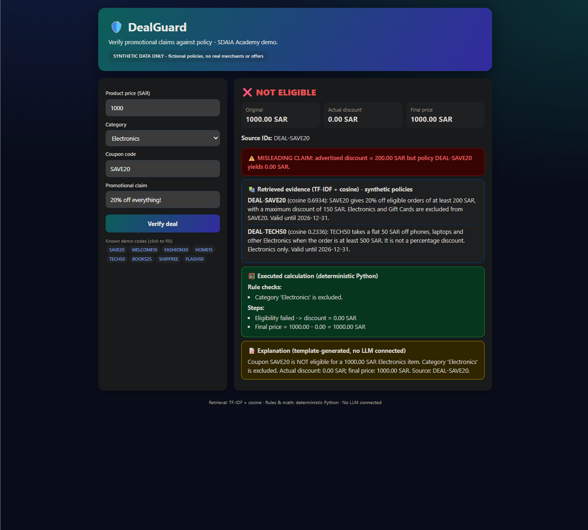

# DealGuard

**A promotional-claim verifier built as a retrieval-grounded, rule-based prototype.**
Developed during SDAIA Academy's Generative AI Solutions Development Program
([github.com/SDAIAAcademy](https://github.com/SDAIAAcademy)).

> **Synthetic data only.** All policies, coupon codes and offers are fictional. No real merchants or offers are involved.

> **Transparency notice: no LLM is used.** The current implementation uses TF-IDF *retrieval* and *template-based* explanations.
> It performs **no generative-AI text generation**. An LLM (e.g. for explanation wording) could be added later as an optional layer; the deterministic rules would remain the source of truth.

## Objectives
- Demonstrate a grounded, auditable pipeline: every verdict cites the policy it came from.
- Show why eligibility and money calculations must be deterministic code, not free-form model output.
- Refuse (rather than guess) when no policy evidence exists.

## Real-world problem
Advertisements such as *"20% off everything!"* often hide exclusions, caps, minimum spends and expiry dates.
Shoppers (or support agents) need to know the *actual* discount. DealGuard compares the advertised claim with the governing policy and flags misleading claims.

## Architecture
```
 input (price, category, coupon, claim)
        |
  1. Validation ............ type/range/format checks (verifier.py)
        |
  2. TF-IDF retrieval ...... cosine similarity over policy texts (retriever.py, stdlib only)
        |
  3. Policy lookup ......... coupon -> policy; unknown/missing coupon => REFUSED (never invents a policy)
        |
  4. Deterministic rules ... expiry, category allow/exclude, minimum spend (verifier.py)
        |
  5. Discount calculation .. percent (with cap) / flat / free-shipping, final price
        |
  6. Claim check ........... parse "%"/SAR amounts in the claim, warn if claim > actual discount
        |
  7. Template explanation .. fixed text built from executed checks, with cited source IDs
```
- **Retrieval** surfaces relevant policy text as evidence (shown with cosine scores). The governing policy for a known coupon is always included.
- **Verification** is plain Python; retrieval does not decide eligibility.
- **Explanation** is a template filled with real computed values, not generated text.

## Setup and launch
Requires Python 3.10+ (uses `X | None` type hints). The recommended launcher uses only the standard library.

```bash
python app_web.py            # optional custom port: python app_web.py 9000
```
Open **http://127.0.0.1:8765**.

Optional Gradio UI (needs `pip install -r requirements.txt`):
```bash
python app.py
```
> **Windows restriction:** on machines with Windows Application Control policies, `python app.py` can fail with
> `ImportError: DLL load failed while importing aggregations: An Application Control policy has blocked this file.`
> Gradio imports pandas, whose native DLL is blocked. Security settings are neither changed nor bypassed;
> use `app_web.py`, which has no third-party dependencies.

## Example scenario
Input: price `1000` SAR, category `Fashion`, coupon `SAVE20`, claim `20% off everything!`

| Output | Value |
|---|---|
| Status | ELIGIBLE |
| Calculation | 1000.00 x 20% = 200.00, capped at 150 SAR |
| Actual discount / final price | 150.00 SAR / 850.00 SAR |
| Warning | Misleading claim: advertised ~200.00 SAR vs. 150.00 SAR actual |
| Source | `DEAL-SAVE20` |

Try also: `SAVE20` + `Electronics` (excluded), `FLASH50` (expired), `FAKE99` (refused: unknown coupon).

## Demo


## Tests
```bash
python -m unittest -v
```
16 tests, standard library only. Last verified result: `Ran 16 tests ... OK`.
Note: policies are valid until 2026-12-31 and `FLASH50` expired 2026-01-31; date-dependent results change after those dates.

## Security considerations
- The local server binds to `127.0.0.1` only and rejects requests with unexpected `Host` headers.
- Inputs are validated server-side (numeric price range, category whitelist, coupon `[A-Z0-9]{3,20}`, claim length <= 300); request bodies are capped at 4 KB.
- All user-provided and policy text is HTML-escaped before rendering.
- No API keys, credentials or network calls; nothing is persisted.

## Known limitations
- Prototype with 8 fictional policies and 6 categories; not for real pricing decisions.
- TF-IDF is lexical; it does not understand paraphrases or other languages (claim parsing recognises `%`, `SAR`/`riyal`/`ريال`, `save`/`off N`).
- Single-item pricing; no coupon stacking, quantities, taxes or shipping fees.
- Explanations are templated, not LLM-generated.
- The local server is a demo server (`http.server`), not hardened for public deployment.

## Files
- `policies.py` - 8 fictional policies (incl. one expired)
- `retriever.py` - TF-IDF + cosine retrieval
- `verifier.py` - validation, rules, calculation
- `app_web.py` - stdlib web UI (recommended)
- `app.py` - Gradio UI (optional)
- `test_dealguard.py` - unit tests

## Attribution
Developed during SDAIA Academy's Generative AI Solutions Development Program - <https://github.com/SDAIAAcademy>.
